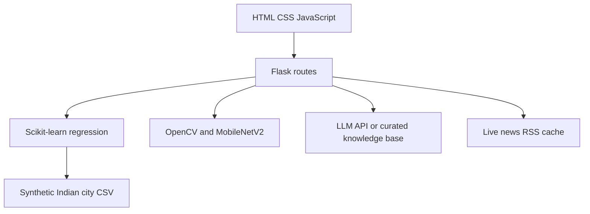

# EcoScanPro — AI-Powered Smart Waste Management System

A responsive Flask web application with three modules: Indian-city waste prediction, OpenCV image preprocessing with optional trained MobileNetV2 waste classification, and Eco AI chat. Includes live environmental news RSS and Chart.js dashboards.

## Problem and objectives
Waste generation is difficult to forecast and waste segregation can be confusing. EcoScanPro demonstrates city-level forecasting, image-assisted sorting and environmental education in one interface. This is a **college demonstration** and not a validated municipal decision system.

## Install and run
Requires Python 3.11+.

```bash
python -m venv .venv
source .venv/bin/activate  # Windows: .venv\\Scripts\\activate
pip install -r requirements.txt
cp .env.example .env  # Windows: copy .env.example .env
python ml/generate_dataset.py
python ml/train_regression.py
python app.py
```

Open http://127.0.0.1:5000. Set `FLASK_DEBUG=1` only for local development. For tests: `pytest -q`.

## Data and regression
`data/indian_waste_data.csv` is **synthetic demonstration data — not official Indian government data**. It includes Delhi, Mumbai, Bengaluru, Chennai, Kolkata, Hyderabad, Pune and Dehradun for 2015–2026, with year, state, city, population, urbanization, per-capita waste and kg/day totals. Generation uses plausible relationships and seeded noise. `ml/train_regression.py` uses a Scikit-learn pipeline (one-hot encoding, standardization, linear regression) with training years 2015–2024 and holdout years 2025–2026. It writes `models/waste_regression.joblib` and `models/regression_metrics.json` (MAE, RMSE, R²). These scores measure only synthetic data performance, not real-world accuracy. Replace the CSV with validated records of the same schema, retrain and re-evaluate before any real deployment. Linear regression is interpretable and a useful educational baseline, but extrapolation can be unreliable.

## Image classification
OpenCV handles image decode, quality checks, resizing and color conversion. A MobileNetV2 convolutional network performs actual classification, **not OpenCV**. The training code lives at `ml/train_classifier.py`; add appropriately licensed labeled images under `data/waste_images/<Category>/`, using these exact categories: Cardboard, Glass, Metal, Organic Waste, Paper, Plastic, General Waste. Install `tensorflow` separately in a supported environment and run `python ml/train_classifier.py`. This downloads pretrained ImageNet weights on first run. The generated `models/waste_classifier.keras` is loaded for inference. No classifier model is bundled, and without one the scanner explicitly returns HTTP 503 and a demonstration-mode notice rather than fake predictions. Validate performance on an **independent** test set before quoting any accuracy. Confidence threshold is 55%; softmax confidence is not guaranteed to be calibrated.

## Eco AI chatbot
Set `LLM_API_KEY`, `LLM_BASE_URL` (OpenAI-compatible chat completions endpoint) and `LLM_MODEL` in `.env` for a live LLM. If unavailable, the app responds using a small curated environmental knowledge base (`data/waste_guidelines.json`) and labels the response as a fallback. No API keys are shipped to the browser.

## Live news
`/api/news` fetches real Google News RSS headlines for waste management and recycling in India with a 30-minute in-process cache. It returns an explicit error and optional cached articles when unavailable. Headlines and URLs come from the feed, never fabricated.

## REST API
- `GET /api/health` — health and classifier readiness.
- `GET /api/dataset` — synthetic city-year records and disclaimer.
- `GET /api/model-comparison` — synthetic dataset values versus regression estimates.
- `POST /api/predict` — JSON with `year`, `state`, `city`, `population`, `urbanization_percentage` (optional `estimated_waste_per_capita_kg_day`); returns kg/day and tonnes/day.
- `POST /api/classify-waste` — multipart `image` JPG/PNG/WEBP; returns category, confidence, top three, guidance, or explicit unavailable/error.
- `POST /api/chat` — JSON `message`, optional `history` array; returns `response` and `mode`.
- `GET /api/news` — live RSS articles or fallback status.

## Architecture


## Security, limitations and future improvements
Uploads are size-limited, image content is verified, and rendered chat/news text is escaped by `textContent`. Secrets stay server-side. For public deployment add production WSGI hosting, HTTPS, CSRF controls as applicable, stronger rate limiting, monitoring, strict upstream RSS timeout handling, content security policy and abuse controls. The current RSS client library may use its own network timeout behavior. No real dataset, licensed training images, trained classifier or LLM key is included. Predictions can be negative internally (clamped to zero), and future projections use illustrative demographic growth assumptions. Future work: verified Indian municipal datasets, AQI integration, independent classification test set, calibrated confidence, additional waste categories and city-specific disposal rules.
