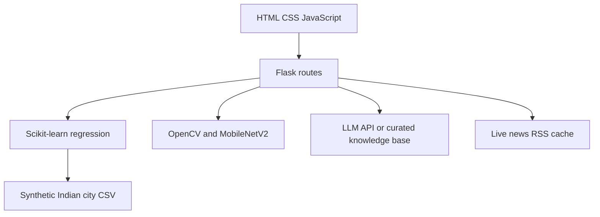

# EcoScanPro — AI-Powered Smart Waste Management System

A responsive Flask web application with three modules: Indian-city waste prediction, OpenCV image preprocessing with optional trained MobileNetV2 waste classification, and Eco AI chat. Includes live environmental news RSS and Chart.js dashboards.

## Problem and objectives
Waste generation is difficult to forecast and waste segregation can be confusing. EcoScanPro demonstrates city-level forecasting, image-assisted sorting and environmental education in one interface. This is a **college demonstration** and not a validated municipal decision system.

## Install and run
Requires Python 3.11+.

```bash
python -m venv .venv
source .venv/bin/activate  # Windows: .venv\\Scripts\\activate
pip install -r requirements.txt
cp .env.example .env  # Windows: copy .env.example .env
python ml/generate_dataset.py
python ml/train_regression.py
python app.py
```

Open http://127.0.0.1:5000. Set `FLASK_DEBUG=1` only for local development. For tests: `pytest -q`.

## Data and regression
`data/indian_waste_data.csv` is **synthetic demonstration data — not official Indian government data**. It includes Delhi, Mumbai, Bengaluru, Chennai, Kolkata, Hyderabad, Pune and Dehradun for 2015–2026, with year, state, city, population, urbanization, per-capita waste and kg/day totals. Generation uses plausible relationships and seeded noise. `ml/train_regression.py` uses a Scikit-learn pipeline (one-hot encoding, standardization, linear regression) with training years 2015–2024 and holdout years 2025–2026. It writes `models/waste_regression.joblib` and `models/regression_metrics.json` (MAE, RMSE, R²). These scores measure only synthetic data performance, not real-world accuracy. Replace the CSV with validated records of the same schema, retrain and re-evaluate before any real deployment. Linear regression is interpretable and a useful educational baseline, but extrapolation can be unreliable.

## Image classification — EcoScanPro V2
OpenCV decodes, checks and resizes uploaded images. A MobileNetV2 CNN with ImageNet-pretrained weights performs classification. The V2 training script at `ml/train_classifier.py` supports eight classes: `Cardboard`, `Glass`, `Metal`, `Organic Waste`, `Paper`, `Plastic`, `General Waste`, `E-Waste`. The updated `routes/classification.py` must be used with the V2 model: preprocessing is built into the saved model, so inference must not apply MobileNetV2 normalization a second time.

### Image dataset provenance and credits
| Category | Dataset/source | Current status | Notes |
| --- | --- | --- | --- |
| Cardboard, Glass, Metal, Paper, Plastic | [TrashNet by Gary Thung and contributors](https://github.com/garythung/trashnet) | Downloaded and organized locally | 403 cardboard, 501 glass, 410 metal, 594 paper, 482 plastic images. |
| General Waste | [TrashNet](https://github.com/garythung/trashnet) `trash` folder | Downloaded and organized locally | 137 images; relabeled `General Waste` for this project's class scheme. |
| Organic Waste | [Waste Classification Data (Kaggle)](https://www.kaggle.com/datasets/techsash/waste-classification-data) — candidate | **Not yet downloaded or integrated** | Inspect the `organic` class, dataset terms, and duplicates before inclusion. |
| E-Waste | [Kaggle dataset discovery](https://www.kaggle.com/datasets?search=e-waste) — candidate search | **No dataset selected or integrated yet** | Choose a licensed dataset with labeled electronic devices, ideally mice, keyboards, chargers and circuit boards. Verify category definitions and permissions. |

The 2,527 TrashNet images are the **only image dataset confirmed integrated** so far. The extra two classes are planned, not trained. This README does not claim a verified license for any candidate dataset; check each source's license and attribution terms before redistribution or public use. Do not commit image datasets to GitHub unless permitted.

### Data preparation
Put correctly labeled images under `data/waste_images/<Category>/`, using the exact eight class names listed above. Check for corrupt files, class imbalance, mislabeled examples, duplicate/near-duplicate images and overlapping sources. Keep photographs of the same object or near-duplicates in the same data split to avoid inflated evaluation results. The V2 script currently performs a seeded stratified random 70/15/15 train/validation/test split, not group-aware deduplication; audit duplicates before training. It requires at least 30 images in every class, but hundreds of varied images per new class are preferable.

### Train and evaluate
```bash
python -m pip install tensorflow scikit-learn opencv-python-headless pillow
python ml/train_classifier.py
```
The training script applies augmentation, trains a frozen MobileNetV2 feature extractor, then fine-tunes selected final layers. It writes `models/waste_classifier.keras`, `models/waste_classifier_classes.json`, and `models/waste_classifier_test_metrics.json`. The held-out test split is useful but is not a substitute for evaluation on genuinely new photos from different devices/backgrounds. A softmax confidence value is **not** a guarantee of correctness; unknown or out-of-distribution items can still receive high scores. Report test metrics only after running the actual V2 training script.

### Model status
A previous six-class TrashNet model was trained locally, with approximately 96.49% final training accuracy and 83.76% final validation accuracy shown in a development screenshot; these are **not V2 results** and are not independently verified test-set metrics. The eight-class V2 model is **not yet trained** because Organic Waste and E-Waste images are still missing.

## Eco AI chatbot
Set `LLM_API_KEY`, `LLM_BASE_URL` (OpenAI-compatible chat completions endpoint) and `LLM_MODEL` in `.env` for a live LLM. If unavailable, the app responds using a small curated environmental knowledge base (`data/waste_guidelines.json`) and labels the response as a fallback. No API keys are shipped to the browser.

## Live news
`/api/news` fetches real Google News RSS headlines for waste management and recycling in India with a 30-minute in-process cache. It returns an explicit error and optional cached articles when unavailable. Headlines and URLs come from the feed, never fabricated.

## REST API
- `GET /api/health` — health and classifier readiness.
- `GET /api/dataset` — synthetic city-year records and disclaimer.
- `GET /api/model-comparison` — synthetic dataset values versus regression estimates.
- `POST /api/predict` — JSON with `year`, `state`, `city`, `population`, `urbanization_percentage` (optional `estimated_waste_per_capita_kg_day`); returns kg/day and tonnes/day.
- `POST /api/classify-waste` — multipart `image` JPG/PNG/WEBP; returns category, confidence, top three, guidance, or explicit unavailable/error.
- `POST /api/chat` — JSON `message`, optional `history` array; returns `response` and `mode`.
- `GET /api/news` — live RSS articles or fallback status.

## Architecture


## Live website — Render deployment
**Live EcoScanPro URL:** `https://YOUR-RENDER-SERVICE.onrender.com` **(placeholder — replace after deployment)**

**Deployment status:** Not yet confirmed. Add the actual Render URL here after a successful deploy. Example link format: `[Open EcoScanPro](https://YOUR-RENDER-SERVICE.onrender.com)`.

### Deploy on Render
1. Push the application source to GitHub, excluding `.env`, `.venv/`, `trashnet/`, raw datasets and private credentials. Do not accidentally exclude required trained model artifacts if the hosted scanner needs them.
2. Create a **Web Service** connected to the repository. Set the Python runtime to a version compatible with all pinned dependencies (for example, Python 3.11 or 3.12).
3. Use build command `pip install -r requirements.txt` and start command `gunicorn app:app --bind 0.0.0.0:$PORT`. Add `gunicorn` to `requirements.txt` if missing.
4. Configure secrets under Render **Environment**, never in GitHub. Set the relevant `LLM_API_KEY`, `LLM_BASE_URL`, `LLM_MODEL`, and other keys only if those services are enabled.
5. Ensure the saved `.keras` model and class-mapping JSON are available on the deployed instance; training locally does **not** automatically transfer these files. Large TensorFlow models may exceed low-memory instance limits. Verify `/api/health`, `/scanner`, `/api/classify-waste`, and `/api/chat` after deployment.
6. Replace the placeholder URL above with the real Render domain and update this section whenever the deployment changes.

For production, consider hosting the classifier separately if TensorFlow exceeds the web service's memory or cold-start budget. A running homepage alone does not establish that the AI classifier is deployed successfully.

## Security, limitations and future improvements
Uploads are size-limited, image content is verified, and rendered chat/news text is escaped by `textContent`. Secrets stay server-side. For public deployment add production WSGI hosting, HTTPS, CSRF controls as applicable, stronger rate limiting, monitoring, strict upstream RSS timeout handling, content security policy and abuse controls. The current RSS client library may use its own network timeout behavior. The waste forecasting dataset is synthetic; TrashNet images were acquired locally during development, but the raw images are not bundled in this README. The eight-class V2 classifier and live LLM configuration are not yet confirmed deployed. Predictions can be negative internally (clamped to zero), and future projections use illustrative demographic growth assumptions. Future work: verified Indian municipal datasets, AQI integration, independent classification test set, calibrated confidence, additional waste categories and city-specific disposal rules.
